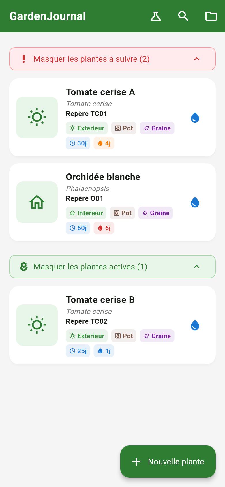
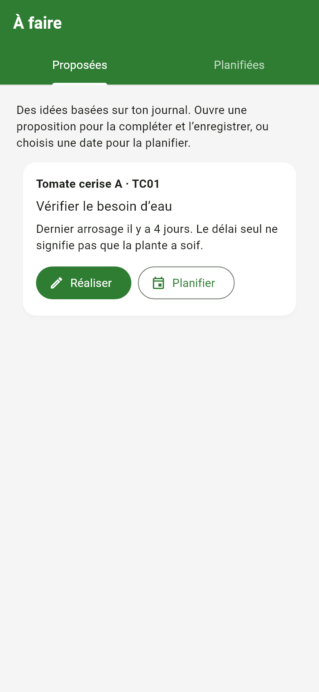
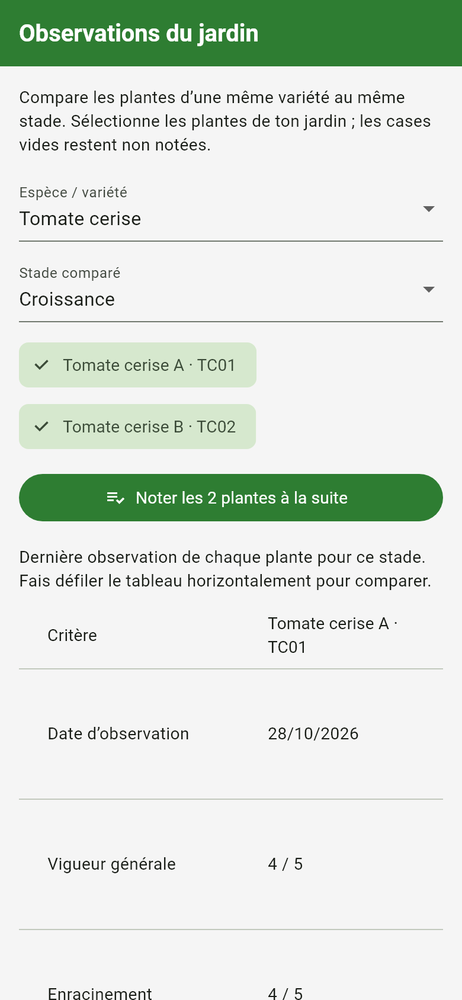
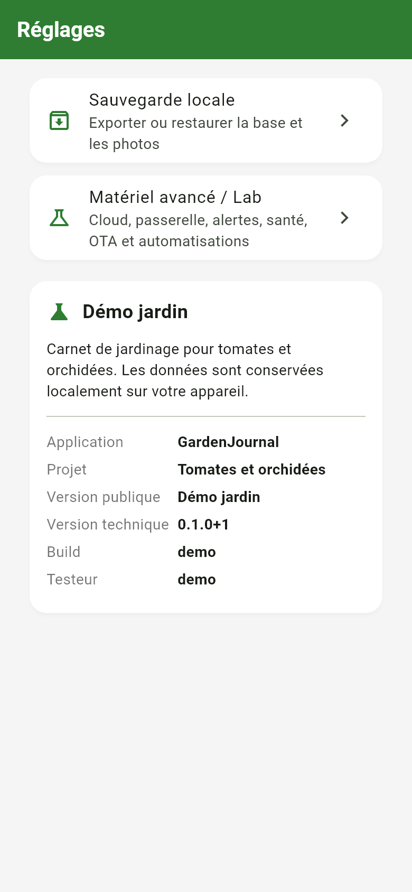

# Plant Tracker — GardenJournal

Local-first Flutter application with SQLite, ESP32 sensor integration and an
optional Raspberry Pi backend. GardenJournal brings together a mobile garden
journal, environmental monitoring and embedded communication services.

## Overview

The Android application tracks tomatoes, orchids and their growing spaces.
Plant records and manual care actions work offline; sensor synchronisation,
cameras and remote services are optional. The interface is in French.

## Preview

These are real Flutter screens rendered with fictional plants and in-memory
repositories. The application starts without plant records or photos.

| Plants | Care tasks |
| --- | --- |
|  |  |

| Observations | Settings |
| --- | --- |
|  |  |

## Main technical work

- **Mobile application:** plant records, groups, dated placements, watering
  reminders, care planning and observations with comparison tables.
- **Local persistence:** SQLite migrations, foreign keys, transactions, photo
  storage, form drafts and validated backup/import with integrity checks.
- **Sharing:** QR codes, printable labels and PDF journals with bundled fonts.
- **Embedded integration:** ESP32 HTTP telemetry, incremental history retrieval,
  BLE provisioning, typed measurements and sensor calibration.
- **Connected services:** Python APIs, camera gateway, MQTT deduplication,
  LoRa message validation, bounded commands and signed OTA verification.
- **Verification:** repository tests, migration tests, simulated network failures
  and mobile layout checks. GitHub Actions runs the automated checks.

## API and backend

A custom Python/SQLite API was developed, deployed on a Raspberry Pi and used
with the mobile application and ESP32 sensor measurements. The backend is
functional in the project's private setup.

It handles authenticated telemetry ingestion, measurement history, device
credentials and a read-only projection of the plant journal. A local collector
forwards ESP32 readings, while the Flutter client retrieves measurements and
publishes the journal snapshot. The phone keeps the authoritative local data.

The API source and its automated tests are included in [cloud_api/](cloud_api/README.md).
Deployment addresses, access credentials and operational data are configured
locally. See the [API overview](cloud_api/README.md) for implementation details.

## Architecture

```text
Flutter screens / widgets
        |
ChangeNotifier providers
        |
Repositories and services
        |
SQLite | local ESP32 | optional Python services
```

Manual actions and sensor measurements are stored separately. Measurements keep
their historical zone, and the local application remains the source of truth.
See [ARCHITECTURE.md](ARCHITECTURE.md).

## Technical stack

| Area | Technologies |
| --- | --- |
| Mobile | Dart, Flutter, Provider / ChangeNotifier |
| Persistence | SQLite, sqflite, application-managed photo storage |
| Embedded | ESP32, Arduino C++, I2C, LittleFS, BLE, HTTP, MQTT, LoRa |
| Backend | Python standard library, SQLite, Docker Compose |
| Validation | Flutter tests, Python unittest, GitHub Actions |

## Getting started

Install Flutter with Dart `>=3.3.0 <4.0.0`, Java 17 and an Android SDK.

```sh
flutter pub get
flutter analyze
flutter test
python tool/check_public_files.py
```

See [SETUP.md](SETUP.md) for emulator, firmware and optional service setup.

## Configuration

Configuration models are text templates with empty or placeholder values.
Real network credentials, tokens, environment files, signing keys and firmware
configuration headers are excluded from version control. A source check rejects
tracked `.h` / `.hpp` files and common secret-file types.

See [SECURITY.md](SECURITY.md). No hosted backend is required for the local journal.

## Project status

Demonstration version `0.1.0+1`, targeting Android. Automated tests cover the app
and Python services; the Android debug build has been compiled locally.
Radio/PCB behaviour, firmware on target hardware, notification delivery and
signed release distribution require separate hardware validation.

Bundled fonts and third-party dependencies retain their respective licences.
